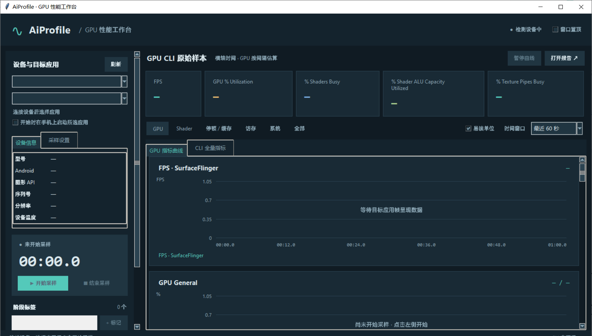
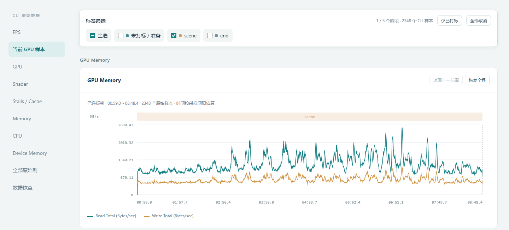

# ai-profile

Android 真机 GPU 性能采样技能（Agent Skill）：驱动 Qualcomm `sdpcli` 采集 Adreno GPU 硬件计数器，
提供桌面工作台、阶段打标、SurfaceFlinger FPS，并生成保留原始 CSV 的离线时间轴报告。
可被 Claude Code 等支持 `SKILL.md` 的 Agent 调用，也可直接当命令行工具使用。

## 截图

桌面工作台（未采样状态）：



离线报告：按阶段标签筛选，查看内存带宽曲线：



## 功能

- 桌面工作台：选择设备与应用，实时查看 GPU 曲线与 FPS，回车或预设标签打阶段标记。
- 保留原始数据：沿用 sdpcli 原始列名与数值，原 CSV 可按字节核对，不做单帧折算。
- 离线报告：单文件 `timeline.html`，支持标签筛选、图例开关、易读单位与原始值切换。
- 命令行与 Agent 指令：`start` / `mark` / `stop` / `gui`，以及 `/profile-start` 等斜杠指令技能。

## 安装

```bash
git clone https://github.com/lala-lzw/ai-profile.git
cd ai-profile
./install.sh          # macOS / Linux，默认装到 ~/.claude/skills
.\install.ps1         # Windows PowerShell
```

脚本接受目标目录参数，其他 Agent 指向各自的技能目录即可。
也可直接把 `skills/ai-profile`（以及可选的 `skills/profile-*`）复制过去。

## 依赖（需自备）

- Python 3（桌面面板需 Tkinter），ADB，已开启 USB 调试并授权的骁龙 / Adreno Android 设备。
- Qualcomm Snapdragon Profiler CLI 的 Android 包。它受高通许可约束，本仓库不分发，
  下载与配置见 [sdpcli 安装指引](skills/ai-profile/references/sdpcli_setup.md)。

## 使用

```bash
python skills/ai-profile/scripts/aiprofile_cli.py gui             # 打开工作台
python skills/ai-profile/scripts/aiprofile_cli.py start           # 后台采样（默认前台应用）
python skills/ai-profile/scripts/aiprofile_cli.py mark "Boss战"    # 打标签
python skills/ai-profile/scripts/aiprofile_cli.py stop            # 结束并生成报告
```

数据口径与产物说明见 [SKILL.md](skills/ai-profile/SKILL.md)。

## 与 PerfDog 对照

在 iQOO 10 上对同一 Demo 的两次独立运行做过对照：28 项 GPU 计数器的曲线相关系数中位数为 0.937，FPS 因贴近帧率上限不具参考性。
仅为单设备单次结果，条件、局限与全部指标见 [对照验证](docs/perfdog_comparison.md)；
对照脚本为 `skills/ai-profile/scripts/compare_perfdog.py`，脱敏示例数据与离线报告见 [examples/iqoo10-demo](examples/iqoo10-demo/README.md)。

## 平台

Windows 已在真机上使用；macOS / Linux 的自动化测试由 CI 覆盖，真机采样尚未验证，欢迎反馈。

## 测试

```bash
cd skills/ai-profile && python -m unittest discover -s tests -v
```

## 许可

[MIT](LICENSE)。Qualcomm sdpcli 及其依赖库不属于本仓库，请按其官方许可使用。
