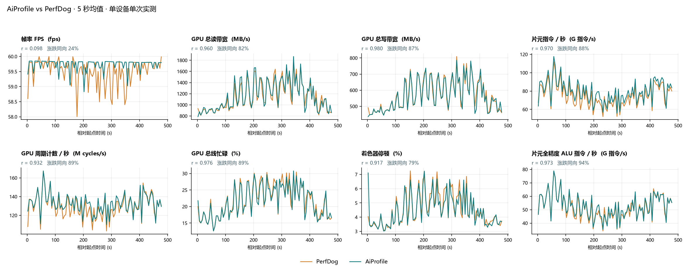

# 与 PerfDog 的对照验证

本页记录一次 AiProfile 与 PerfDog 的对照结果，用来说明两者采到的 GPU 计数器曲线形状是否一致。
结论只适用于下述单台设备、单个 Demo、单次运行，不能推广到所有设备或应用。



## 测试条件

| 项目 | 内容 |
| --- | --- |
| 设备 | iQOO 10 |
| 被测内容 | 作者自制的 Demo，两次运行使用同一台设备 |
| PerfDog | 导出 `.xlsx`，每 1 秒一个样本，运行于 2026-10-27 |
| AiProfile | sdpcli 原始 CSV，配置采样间隔 200 ms，运行于 2026-10-30 |
| 比较区间 | 起点标签 `scene` 至终点标签 `end`，约 477 秒 |
| 聚合 | 每 5 秒取均值，共 96 个窗口；某一侧缺失的窗口不参与统计 |

**两次是独立运行，相隔三天，不是同时采集。** 因此绝对数值、局部峰谷都会有差异，下面比较的是曲线形状。

## 结果

- 28 项 GPU 计数器的 Pearson r 中位数为 **0.937**，其中 21 项 r ≥ 0.90，最低一项为 0.690（SP Memory Read）。
- 只平移起点、不校正时长时，中位 r 为 0.576。时间轴校正对结果影响很大，见下文。
- FPS 的 r 仅 0.098。两边均值分别为 AiProfile 59.73、PerfDog 59.51，
  都贴着 60 帧上限，小幅抖动对相关系数没有参考意义，这一项不能当作一致性的证据。

## 为什么要校正时间轴

sdpcli 的 CSV 没有逐行时间戳，AiProfile 的 GPU 横轴由「样本序号 × 配置间隔」估算，实际采样间隔会有偏差。
本次区间在估算轴上是 469.6 秒，而两个标签的实际间隔是 477.4 秒，估算轴短了约 1.6%。
默认做法是把估算轴线性拉伸到实际打标时长，比例由两次标记的时间独立确定，没有用曲线拟合。
标签由人工点击，存在操作延迟，所以这个校正仍是估算。FPS 有独立的经过时间，只需减去起点。

## 指标说明

- **r**：Pearson 相关系数，衡量形状一致性，不代表数值相等。
- **涨跌同向**：相邻窗口的变化方向相同的比例；变化小于该曲线 P95−P5 范围 2% 的视为平稳，双方都平稳的跳变不计。
- **对称均值差异**：2×|均值差| / (|均值A|+|均值B|)，两边地位相同。
- 缺失值不补零，不翻转或缩放任何指标。

## 全部指标

| 指标 | r（校正） | r（仅平移） | 涨跌同向 | 对称均值差异 |
| --- | ---: | ---: | ---: | ---: |
| Avg Bytes / Fragment | 0.989 | 0.513 | 91% | 1.7% |
| L1 Texture Cache Miss Per Pixel | 0.984 | 0.584 | 88% | 0.1% |
| % Linear Filtered | 0.980 | 0.382 | 96% | 0.1% |
| Write Total (Bytes/sec) | 0.980 | 0.651 | 87% | 0.6% |
| GPU % Bus Busy | 0.976 | 0.682 | 89% | 1.4% |
| % Texture Fetch Stall | 0.975 | 0.292 | 89% | 3.4% |
| Fragment ALU Instructions / Sec (Full) | 0.973 | 0.595 | 94% | 1.2% |
| Texture Memory Read BW (Bytes/Second) | 0.973 | 0.659 | 89% | 1.9% |
| Fragment Instructions / Second | 0.970 | 0.596 | 88% | 6.0% |
| % Texture L1 Miss | 0.965 | 0.647 | 89% | 0.2% |
| ALU / Fragment | 0.965 | 0.563 | 90% | 0.4% |
| Read Total (Bytes/sec) | 0.960 | 0.638 | 82% | 1.4% |
| Fragment ALU Instructions / Sec (Half) | 0.947 | 0.566 | 87% | 1.3% |
| % Prims Clipped | 0.942 | 0.754 | 86% | 2.8% |
| Clocks / Second | 0.932 | 0.439 | 89% | 2.1% |
| % Texture L2 Miss | 0.930 | 0.536 | 92% | 2.5% |
| % Time Shading Fragments | 0.923 | 0.609 | 78% | 0.0% |
| % Shaders Stalled | 0.917 | 0.608 | 79% | 1.7% |
| Fragments Shaded / Second | 0.912 | 0.406 | 84% | 1.1% |
| Vertex Memory Read (Bytes/Second) | 0.906 | 0.569 | 80% | 2.9% |
| Vertex Instructions / Second | 0.905 | 0.558 | 69% | 3.3% |
| Avg Bytes / Vertex | 0.896 | 0.702 | 81% | 1.0% |
| Vertices Shaded / Second | 0.895 | 0.537 | 80% | 1.4% |
| % Shaders Busy | 0.886 | 0.643 | 84% | 1.2% |
| % Stalled on System Memory | 0.878 | 0.622 | 79% | 21.0% |
| % Vertex Fetch Stall | 0.866 | 0.457 | 80% | 10.4% |
| % Texture Pipes Busy | 0.832 | 0.452 | 84% | 1.2% |
| SP Memory Read (Bytes/Second) | 0.690 | 0.225 | 75% | 16.1% |
| FPS | 0.098 | 0.098 | 24% | 0.4% |

## 局限

- 单设备、单个 Demo、单次运行；两次运行日期不同。
- 时间对齐依赖人工标签和线性校正。
- PerfDog 的计数器来自其导出表中名称相同的列，本文未核对两者的内部定义是否完全相同。
- 这是对照而非认证。PerfDog 是其权利人的产品，本项目与其无关联。

## 复现

```bash
python skills/ai-profile/scripts/compare_perfdog.py <AiProfile 会话目录> <PerfDog.xlsx> --out-dir out --plot
python skills/ai-profile/scripts/compare_perfdog.py <会话目录> <PerfDog.xlsx> --out-dir out --align shift
```

会话目录需包含 `summary.json`，且至少有起点和终点两个标签。结果表输出为 `out/perfdog_comparison_*.csv`。
